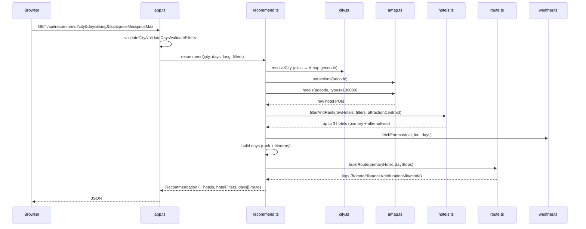
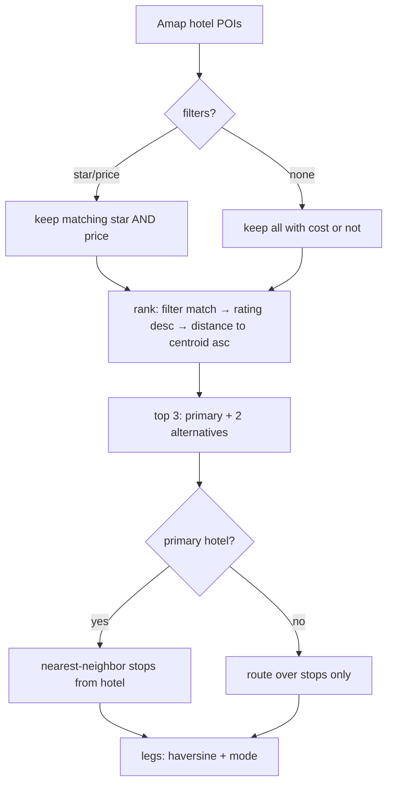

# Design

## Context & Background
The planner already resolves a Chinese city, ranks weather-aware attractions, and builds a per-day itinerary (`src/recommend.ts`, `src/rank.ts`, `src/itinerary.ts`). This change adds three things on top: a redesigned search with optional hotel preferences, hotel recommendations, and a per-day route anchored at the hotel. The stack stays Node/TypeScript with a vanilla static frontend; Amap is the only new data source (hotel POIs), and routing is computed locally.

Constraints:
- One Amap key (`AMAP_KEY`/`AMAP_API_KEY`), server-side only; search quota is ~100/day (personal) so hotel lookups must be cached.
- Existing contract is additive; no existing field changes.
- Routes must not depend on Amap direction APIs (quota/latency); offline distance/time is acceptable.

## System Architecture


Flow of hotel + route decisions:


## Interface Contracts
```ts
type Star = 3 | 4 | 5;
interface HotelFilters { star?: Star; priceMin?: number; priceMax?: number }

interface Hotel {
  id: string;
  name_zh: string;
  star?: number;          // derived from Amap typecode (100102→5, 100103→4, 100104→3)
  price?: number;         // biz_ext.cost (per person / night), undefined if unknown
  rating?: number;        // biz_ext.rating
  address?: string;
  image: string | null;   // https Amap photo or null
  reason: string;         // localized
  primary: boolean;
  lat: number;
  lon: number;
}

type Mode = "walk" | "drive";
interface RouteLeg { from: string; to: string; distanceKm: number; durationMin: number; mode: Mode }
interface DayRoute { legs: RouteLeg[]; totalDistanceKm: number; totalDurationMin: number }

// GET /api/recommend?city=<name>&days=<1..16>&lang=<en|zh-CN>&star=<3|4|5>&priceMin=<int>&priceMax=<int>
interface RecommendResponse {
  lang: "en" | "zh-CN";
  city: { name: string; name_zh: string; admin1: string; lat: number; lon: number };
  hotels: Hotel[];              // additive
  hotelFilters: HotelFilters;   // echo (additive)
  days: Array<{
    date: string; weather: Weather; advice: string;
    attractions: RankedAttraction[];
    itinerary: ItineraryStop[];
    route: DayRoute;            // additive
  }>;
  summary: string;
  notices: string[];
}
```

## External API Integration
- **Hotel POIs**: `GET https://restapi.amap.com/v3/place/text?types=100000&city=<adcode>&citylimit=true&extensions=all&offset=25&page=1`.
  - Star: `typecode` → `100101/100102`→5★, `100103`→4★, `100104`→3★, `100105`→economy (star 2).
  - Price/rating: `biz_ext.cost`, `biz_ext.rating` (may be absent → `undefined`).
  - Photos: `photos[].url` (https only).
- **Caching**: extend `AmapClient` with a hotel cache keyed by `adcode + filters` (TTL = existing `cacheTtlMs`). One shared client per app (already in `createApp`).
- **Error taxonomy**: a hotel API failure is an upstream failure → `503 attraction_source_unavailable` (consistent with the retained taxonomy). A successful response with **zero** hotels is not an error: return `hotels: []` + a localized notice, and build routes without hotel endpoints (AC14).
- **Routing**: no external calls. Haversine distance + fixed speeds (walk 5 km/h, drive 25 km/h) for `durationMin`.

## UI/UX Design & Aesthetics
- **Search redesign**: reuse existing tokens (`--accent`, `--line`, `--radius`).
  - Row layout on desktop: `[city] [days] [language] [Hotel preferences ▾] [Search]`; stacks to a single column ≤420px.
  - `Hotel preferences` is a collapsible `<details>` with **Star** (`Any/3★+/4★+/5★`) and **Price** (`min`–`max` number inputs).
  - States: idle (hint), loading (skeleton/spinner text), error (inline, friendly), empty (no hotels notice).
  - A "Clear" action resets city/days/filters and results.
- **New sections** (top→bottom): Trip plan (itinerary) → **Hotels** (primary highlighted + alternatives) → Daily status (weather + cards) → per-day **Route** (ordered legs with mode/distance/time).
- **Responsive breakpoints**: 420px (stack), 768px (2-col cards), 1280px (wider container) — already defined; extend for hotels/route grids.

## Security & NFRs
- Validate `star ∈ {3,4,5}`, `priceMin/priceMax` non-negative integers, `priceMin ≤ priceMax`; reject with `400 invalid_input`.
- API key never leaves the server; hotel cache is keyed without the key and bounded per city.
- Route computation is bounded by the day's itinerary length (≤ 4 stops) + hotel; no unbounded loops.
- Keep p95 < 2000 ms warm; hotel fetch reuses the existing 3000 ms timeout.

## Decisions & Migration
- **Offline routing** over Amap directions: deterministic, no extra quota/latency; Amap directions can replace `route.ts` later without contract changes.
- **One primary hotel per trip**: simplest sensible model for city breaks; alternatives are informational.
- **Additive contract**: `hotels`, `hotelFilters`, `days[].route` are new; clients that ignore them keep working.
- **Hotel API failure = 503** (retained taxonomy); **zero hotels = 200 + notice** (AC14).
- Migration: no data migration; deploy is a normal release. Existing tests remain valid; new tests cover AC1–AC14.
