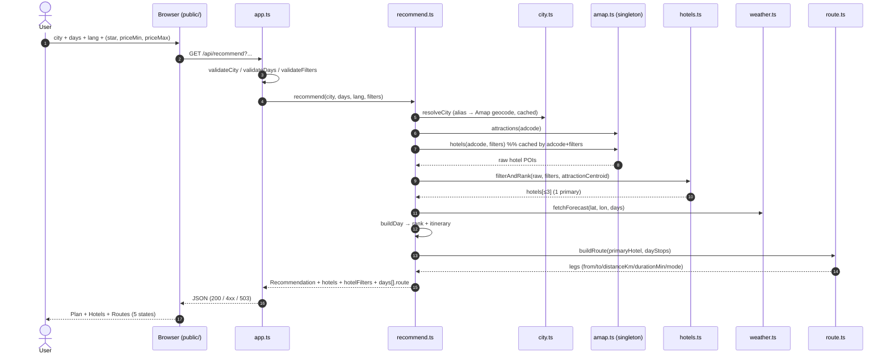

# Technical Design: hotel-route-search-redesign

> Requirement: "在现有 '天气感知景点推荐' 基础上新增: (1) 重新设计顶部搜索框,改善用户体验; (2) 推荐计划中加入住宿酒店推荐,并支持在顶部搜索框以可选方式输入酒店星级或价格区间; (3) 在给出推荐酒店后,提供包含酒店的出行路线/日程安排"
> Purpose: Concrete architecture, interface contracts, external integration models, and UI/UX specifications.
> NOTE: This document guides implementation (HOW). Behavioral BDD requirements live in spec.md.

## 1. Context & Background
The planner (`src/recommend.ts`) already resolves a city, ranks weather-aware attractions (`src/rank.ts`), builds a per-day itinerary (`src/itinerary.ts`), and serves a vanilla static frontend. Existing patterns to reuse:
- `AmapClient` is a **single long-lived instance** created in `createApp` with a per-city TTL cache (`src/amap.ts`, `src/app.ts`).
- Errors use a typed `AppError` taxonomy (`error_code`, HTTP status) and a `{ error_code, message }` body (`src/errors.ts`, `src/app.ts`).
- i18n uses server-side catalogs with parity enforcement (`src/i18n.ts`).
- UI tokens live in `public/index.html` `:root`.

Constraints: one server-side Amap key; Amap search quota ~100/day (personal) shared by attraction + hotel lookups; routing must not add quota/latency; the contract change must be additive.

## 2. System Architecture & Component Interaction


## 3. Interface Contracts & Data Models
Established convention (kept for consistency): `GET /api/recommend` with query params and a `{ error_code, message }` error body (not Stripe/RFC 7807 envelopes, which would break the existing client).

**`api-design` alignment / deliberate deviation**: the endpoint verb (`/api/recommend`) and the flat response envelope predate this change; migrating to `/api/v1/recommendations` + `data`/`meta` is **breaking** and out of scope for this additive change (a future version can add an alias). Status-code semantics already follow the skill (400 for client input, 503 for upstream failure; **no 200-with-error**). Pagination, idempotency keys, and rate-limit response headers are N/A (idempotent GET, no auth).

```ts
// Query (all optional except city)
type Star = 3 | 4 | 5;
interface HotelFilters { star?: Star; priceMin?: number; priceMax?: number }

interface Hotel {
  id: string; name_zh: string;
  star?: number;        // 5|4|3 from typecode; economy → 2
  price?: number;       // biz_ext.cost (per night)
  rating?: number;      // biz_ext.rating
  address?: string;
  image: string | null; // https only
  reason: string;       // localized
  primary: boolean;
  lat: number; lon: number;
}

type Mode = "walk" | "drive";
interface RouteLeg { from: string; to: string; distanceKm: number; durationMin: number; mode: Mode }
interface DayRoute { legs: RouteLeg[]; totalDistanceKm: number; totalDurationMin: number }

interface RecommendResponse {
  lang: "en" | "zh-CN";
  city: { name: string; name_zh: string; admin1: string; lat: number; lon: number };
  hotels: Hotel[];                 // additive (≤3)
  hotelFilters: HotelFilters;      // echo
  days: Array<{
    date: string; weather: DayWeather; advice: string;
    attractions: RankedAttraction[];
    itinerary: ItineraryStop[];
    route: DayRoute;               // additive
  }>;
  summary: string;
  notices: string[];
}
```

Error contract (existing, extended):
| Case | HTTP | `error_code` |
| :-- | :-- | :-- |
| bad city/days/filters | 400 | `invalid_input` |
| unresolved city | 400 | `unknown_city` |
| multiple city-level matches | 400 | `ambiguous_city` (+ `candidates[]`) |
| weather upstream failure | 503 | `forecast_unavailable` |
| attraction/hotel upstream failure | 503 | `attraction_source_unavailable` |
| zero hotels / zero attractions | 200 | notice in `notices[]` |

## 4. External Services & 3rd-Party API Integration
- **Endpoint**: `GET https://restapi.amap.com/v3/place/text?types=100000&city=<adcode>&citylimit=true&extensions=all&offset=25&page=1&key=<key>`.
- **Auth**: Web Service key from `AMAP_KEY`/`AMAP_API_KEY`; server-side only, never sent to the browser.
- **Data mapping**: star from `typecode` (`100101/100102`→5, `100103`→4, `100104`→3, `100105`→2); `price`←`biz_ext.cost`; `rating`←`biz_ext.rating`; `image`←first `photos[].url` that is `https`; `address`←`address`.
- **Quotas**: search ~100/day (personal) shared with attraction search; LBS quota unaffected (no route API).
- **Client lifecycle & caching**: reuse the single `AmapClient`; add a hotel cache keyed by `adcode + normalizedFilters` with TTL = `cacheTtlMs` (default 24h). Never instantiate per request.
- **Retry**: no retry loop; a single 3000 ms `AbortController` timeout; failures map to the taxonomy.
- **Error taxonomy & degradation**:
  - Hotel API failure → `503 attraction_source_unavailable` (consistent with the retained taxonomy).
  - Successful response with **zero** hotels → `200` + localized notice; routes are built without hotel endpoints.
  - [UNVERIFIED: `biz_ext.cost` coverage varies by POI; star typecode coverage is provider-dependent] — validate on live data; filters ignore POIs with unknown values.

## 5. UI/UX Design, Visual Hierarchy & Aesthetics
Grounded in a **consumer travel-planning** product (calm, spacious, image-forward), not a developer dashboard.

### 5.1 Design Direction & Subject Grounding
- Reference: existing `public/index.html` tokens and the current hero/attraction-card system.
- Design Thesis: editorial travel magazine — generous whitespace, one atmospheric hero, image-led cards, restrained accent; the **search + hotel preferences** is the hero moment.

### 5.2 Visual Theme & Design Tokens
Palette (deliberate, WCAG AA):
- `--color-background`: `#f6f8fb` (page canvas); hero canvas `#0f172a`
- `--color-surface`: `#ffffff` (cards)
- `--color-border`: `#e5e9f0`
- `--color-primary`: `#0e7490` (deep teal; buttons/links) with `#0ea5a4` hover
- `--color-accent`: `#f59e0b` (primary-hotel badge / highlights)
- `--color-text-primary`: `#0b1220`; `--color-text-muted`: `#5b6b82` (AA on `#ffffff`)

Typography (intentional pairing, not a default fallback):
- Display/Heading: **"Fraunces"** (editorial serif) for the hero + section titles.
- Body/UI: **"Source Sans 3"** (humanist sans); CJK falls back to `PingFang SC` / `Microsoft YaHei`.
- Numeric: tabular figures (`font-variant-numeric: tabular-nums`) for prices, distances, durations.
- Scale: hero 34–44px bold `-0.02em`; section 20–22px semibold; body 15–16px/1.55; micro 12–13px.

Spacing & radii: `--radius: 18px`; `--spacing-unit: 8px`.

### 5.3 Hero Moment & Component Layout
- Hero: one-line title + subtitle + the **search row** (city, days, language, collapsible **Hotel preferences**, Search, Clear).
- New sections, top→bottom: **Trip plan** (itinerary) → **Hotels** (primary highlighted + alternatives) → **Daily status** (weather strip + attraction cards) → **per-day Route** (ordered legs: mode · distance · time).
- Breakpoints (Vercel-aligned):
  - Mobile `<= 640px`: single column, stacked search, tap targets ≥ 44px.
  - Tablet `641–1024px`: adaptive 2-column card grid.
  - Desktop `> 1024px`: multi-column grids; `> 1280px` wider container with a sticky trip summary.

### 5.4 Mandatory Interactive States
1. **Default**: token-governed cards/controls.
2. **Hover/Focus**: 150–200 ms transitions; visible `:focus-visible` rings on inputs/buttons.
3. **Loading**: content-shaped skeleton cards (hotels/attractions) + disabled Search with progress text — no blank screen or layout shift.
4. **Empty**: when no hotels → empathetic localized notice + "adjust preferences" hint; no attractions → existing notice.
5. **Error**: inline non-blocking banner with the localized `message` and a retry affordance; upstream failure does not blank the page.

Anti-AI-slop: no arbitrary purple-on-black, no gradient text on single words, no uniform pill buttons; the hotel **primary** uses the accent chip while secondary actions stay quiet; layout rhythm varies (atmospheric hero → asymmetric primary-hotel panel → card grid → route list) instead of a monotonous 3-card grid.
- Micro-motion: 150–250 ms `cubic-bezier(0.22, 1, 0.36, 1)` (ease-out); never sluggish.
- Accessibility: every control is Tab-reachable with a visible `:focus-visible` ring; images carry `alt`; icon-only controls carry `aria-label`; hotel star/price filter chips expose their selected state (`aria-pressed`).

## 6. Security Architecture & Operational NFRs
### 6.1 Security & Threat Mitigation
- Input validation & bounds: `city` 1–64 non-blank; `days` 1–16 integer; `star ∈ {3,4,5}`; `priceMin/priceMax` non-negative integers; `priceMin ≤ priceMax`; invalid → `400 invalid_input`.
- Secret lifecycle: Amap key only in server env; never logged (log layer logs code + cause kind only) and never embedded in static assets.
- Path traversal: `serveStatic` uses `path.relative` + absolute check (existing hardening).
- No PII: city input is not persisted; no user identifiers.

### 6.2 Performance Budgets & Operational NFRs
- Latency: p95 < 2000 ms warm; per-upstream timeout 3000 ms.
- Cache bounds: hotel cache keyed by `adcode+filters`, TTL 24h; bounded by distinct cities/filter combos.
- Quota protection: singleton `AmapClient`; no route API calls; hotel search cached.
- Graceful degradation: zero hotels → notice + hotel-less routes; upstream failure → typed 503 with friendly message.

## 7. Key Decisions & Alternatives
- **Offline routing** (haversine + nearest-neighbor, walk ≤2 km else drive) vs Amap directions → chosen for determinism, zero quota/latency; `route.ts` is swappable later.
- **One primary hotel per trip** vs per-night hotels → simplest for city breaks; alternatives are informational.
- **Additive contract** vs versioned endpoint → existing clients keep working.
- **Hotel API failure = 503** vs silent skip → consistent with the retained upstream taxonomy; *zero results* is the only non-error empty case.
- **`biz_ext.cost` as price** vs a paid hotel API → sufficient for a preference filter; missing values degrade.

## 8. Migration, Rollout & Rollback
- No database or data migration. Deploy is a normal release.
- Rollout: additive fields (`hotels`, `hotelFilters`, `days[].route`) and new optional query params; the UI feature-detects absent arrays.
- Rollback: revert the release; old clients are unaffected because all additions are optional. Cache entries are process-local and expire with a restart.
