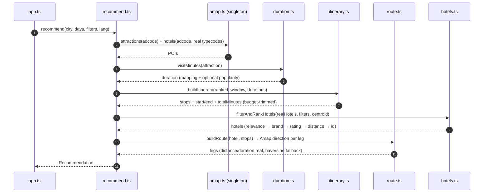

# Technical Design: trip-time-budget-and-hotel-quality

> Requirement: "根据景点规模/类型估算游览时长并按一天时间预算(含交通)安排; 酒店只选真实酒店并优先主流/高星"
> Purpose: HOW — duration model, day scheduling, real travel times, and hotel source/ranking.
> NOTE: Behavioral requirements live in spec.md.

## 1. Context & Background
- `src/itinerary.ts` clusters a day's stops and caps at 3; `src/route.ts` computes haversine legs; `src/amap.ts` (single cached client) fetches attractions and hotels; `src/hotels.ts` filters/ranks.
- Current gaps: no visit duration; haversine is straight-line (not real road time); hotel query uses generic `types=100000` (includes non-hotels) and ranks by rating only.
- Constraints: Amap key server-side; search quota ~100/day; LBS quota larger; no free visit-duration API.

## 2. System Architecture & Component Interaction


## 3. Interface Contracts & Data Models
```ts
interface ItineraryStop {
  slot: string; label: string; id: string; name_zh: string;
  environment: "indoor" | "outdoor" | "mixed";
  visitMinutes: number;   // 30..480
  startTime: string;      // "HH:mm" local
  endTime: string;        // "HH:mm" local
  lat: number; lon: number;
}
interface DayPlan { stops: ItineraryStop[]; totalMinutes: number } // total <= window

interface Hotel {
  id: string; name_zh: string; star?: number; price?: number; rating?: number;
  address?: string; image: string | null; reason: string; primary: boolean;
  brand?: string;         // matched mainstream brand (if any)
  lat: number; lon: number;
}
// Route legs unchanged shape; distanceKm/durationMin now sourced from Amap direction (real).
```
Query unchanged; config adds `WAYFARE_DAY_START/WAYFARE_DAY_END/WAYFARE_DEFAULT_VISIT_MIN/WAYFARE_HOTEL_TYPES/WAYFARE_HOTEL_BRANDS`.

## 4. External Services & 3rd-Party API Integration
- **Amap direction**: `GET /v3/direction/walking?origin=lng,lat&destination=lng,lat&key=` (≤100km) and `/v3/direction/driving?...&extensions=base`; response `route.paths[0].distance` (m) / `duration` (s). Real road time (traffic-aware for driving). Cache per leg (rounded coords) with TTL; failure → haversine fallback (`src/route.ts`).
- **Amap hotels**: `place/text?types=100100|100101|100102|100103|100104|100105&city=<adcode>&citylimit=true&extensions=all`. Excludes generic `100000`/hostels `100200|100201`. Cache per adcode (TTL).
- **OpenTripMap (optional)**: `places/radius?rate=2&kinds=...` gives a popularity `rate` and Wikipedia extracts; used only to nudge duration/popularity when a free key is configured. No duration field.
- **Quotas**: search ~100/day (attractions+hotels, cached); direction on LBS quota (per leg, cached). Timeout 3000ms; failures degrade (haversine) without erroring the plan.

## 5. UI/UX Design, Visual Hierarchy & Aesthetics
- Reuse existing tokens (`public/index.html :root`), fonts (Fraunces/Source Sans 3), and the grouped day layout.
- Itinerary stops now show **time ranges + duration** (e.g. `09:00–10:30 · 90 min`) and the day shows a total; a subtle “day budget” label.
- Hotel cards show **brand/star** and a “mainstream” hint; primary hotel remains accent-badged.
- States unchanged (default/hover/loading skeleton/empty/error) and already asserted by the web smoke test.

## 6. Security & Architecture NFRs
- Validate config bounds: day window ordered, visit durations 30–480, hotel typecodes fixed.
- Keys server-side only; direction/hotel responses cached; no key in logs.
- p95 < 3000 ms warm (extra direction calls), per-upstream 3000 ms timeout; bounded legs (≤3 stops + hotel → ≤4 legs/day).

## 7. Key Decisions & Alternatives
- **System-recommended duration** vs a paid/scraped duration feed → no free duration API exists; configurable mapping + optional OTM popularity is honest and deterministic.
- **Amap direction** vs haversine → real road time; haversine only as fallback.
- **Real hotel typecodes + brand boost** vs generic search → removes parks/non-hotels and surfaces mainstream chains.
- **Single day window + <=3 stops** vs fixed 3 → avoids cramming.

### 7.1 Spec coverage (AC1–AC13)
| AC | Design |
| :-- | :-- |
| AC1–AC4 (itinerary, budget) | §2 itinerary step; §3 `ItineraryStop`/`DayPlan` |
| AC5–AC6 (visit duration) | §2 `duration.ts`; §4 OTM optional; config |
| AC7–AC8 (day window) | §3 `DayPlan`; §4 config bounds |
| AC9–AC10 (real travel) | §4 Amap direction + haversine fallback |
| AC11–AC13 (hotel source/quality) | §4 hotel typecodes; §3 `Hotel.brand`; §7 decisions |

## 8. Migration, Rollout & Rollback
- Additive contract (new fields); existing clients ignore them.
- No data migration. Rollout adds direction calls (LBS quota) and optional OTM key; config has safe defaults.
- Rollback: revert release; haversine fallback and generic-hotel path can be restored by config without schema change.
